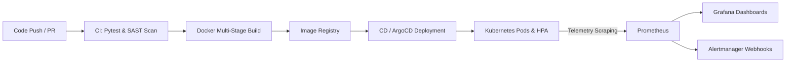

# PROJECT REPORT: AUTOMATED CLOUD-NATIVE APPLICATION DEPLOYMENT WITH MONITORING

**Course / Module:** DevOps & Cloud Computing Engineering  
**Project Title:** Automated Cloud-Native Application Deployment with Monitoring  
**Target Environment:** Containerized Microservices, Kubernetes Orchestration, Cloud Infrastructure (AWS/Local)  
**Status:** Completed & Validated  

---

## 1. ABSTRACT

Modern software delivery paradigms demand high velocity, reliability, and resilience. Traditional monolithic deployments and static manual monitoring are incapable of providing high availability in ephemeral cloud environments. This project presents a complete, end-to-end DevOps framework that automates the deployment and observability of a cloud-native microservice architecture. 

The implementation features an asynchronous Python/FastAPI microservice instrumented with OpenMetrics/Prometheus client libraries, containerized via a security-hardened multi-stage Docker build, orchestrated through declarative Kubernetes manifests and Helm charts, and continuously monitored through a dedicated Prometheus, Grafana, and Alertmanager stack. Infrastructure provisioning is codified via Terraform (IaC) for AWS Elastic Kubernetes Service (EKS). An automated Continuous Integration (CI) and Continuous Delivery (CD) pipeline with zero-downtime rolling deployments and automatic rollback verification ensures safe production releases.

---

## 2. PROBLEM STATEMENT & OBJECTIVES

### 2.1 Problem Statement
Deploying microservice applications manually or without integrated monitoring leads to:
- High Mean Time to Detect (MTTD) and Mean Time to Resolution (MTTR) during failures.
- Inconsistent environments between development, staging, and production.
- Production outages caused by untested code or unmonitored resource spikes.
- Downtime during software upgrades and rollouts.

### 2.2 Project Objectives
1. **Develop a Cloud-Native Microservice:** Provide business logic, health probes (`/healthz`, `/ready`), and OpenMetrics telemetry (`/metrics`).
2. **Hardened Containerization:** Build a slim, multi-stage, non-root Docker container image.
3. **Automated Infrastructure as Code (IaC):** Declaratively provision cloud Kubernetes clusters using Terraform.
4. **Cloud-Native Orchestration:** Manage self-healing, rolling updates, and Horizontal Pod Autoscaling (HPA) using Kubernetes manifests and Helm 3.
5. **Continuous Observability & Dynamic Alerting:** Scrape real-time performance indicators (RPS, Latency percentiles, Error rates, CPU/Memory) via Prometheus, display rich live visual dashboards in Grafana, and dispatch actionable alerts via Alertmanager.
6. **Automated CI/CD Pipeline:** Implement GitHub Actions workflows for static code linting, unit testing, SAST security vulnerability scanning (Trivy), image building, and automated deployment.

---

## 3. ARCHITECTURAL DESIGN & WORKFLOW



### 3.1 Three Pillars of Observability Implemented
1. **Metrics:** Real-time numerical timeseries data tracking request throughput, error counts, latency histograms, and system resource consumption.
2. **Health Checks:** Kubernetes liveness and readiness probes checking runtime responsiveness and routing traffic only when ready.
3. **Alerting Rules:** Proactive notification triggers when error thresholds (>5%) or latency limits (p95 > 500ms) are breached.

---

## 4. DETAILED MODULE IMPLEMENTATION

### Module 1: Cloud-Native Application Layer (`app/`)
- **Framework:** FastAPI with Python 3.11 for asynchronous, high-throughput REST APIs.
- **Metrics Instrumentation:**
  - `http_requests_total`: Counter metric labeled with HTTP method, endpoint, and status code.
  - `http_request_duration_seconds`: Histogram metric recording latency percentiles across standard buckets.
  - `http_active_requests`: Gauge metric tracking in-flight concurrent connections.
  - `app_system_cpu_usage_percent` & `app_system_memory_usage_bytes`: Real-time system resource tracking.
- **Chaos Testing Hooks:**
  - `/api/simulate/error`: Injects 500 internal server errors to validate alert rule activation.
  - `/api/simulate/slow`: Introduces artificial delays to test latency alerts.
  - `/api/simulate/load`: Creates CPU spikes to verify Horizontal Pod Autoscaler (HPA) scale-out behavior.

### Module 2: Containerization & Security Hardening (`app/Dockerfile`)
- **Multi-Stage Architecture:**
  - *Build Stage:* Compiles dependencies and generates Python wheels in an isolated builder container.
  - *Runtime Stage:* Minimal slim base image containing only compiled dependencies and application code.
- **Security Hardening:**
  - Runs under a dedicated, unprivileged non-root user (`appuser`, UID `10001`).
  - Container health check integrated into the Docker manifest.

### Module 3: Infrastructure as Code (`terraform/`)
- **Declarative AWS EKS Provisioning:**
  - Automated Virtual Private Cloud (VPC) with public subnets across multiple availability zones.
  - AWS Internet Gateway (IGW) and Route Table associations.
  - EKS Cluster Control Plane with required IAM roles (`AmazonEKSClusterPolicy`).
  - EKS Managed Node Group with auto-scaling worker nodes (min: 2, desired: 3, max: 6).

### Module 4: Kubernetes Orchestration & Helm Packaging (`k8s/` & `helm/`)
- **Zero-Downtime Deployments:**
  - `RollingUpdate` strategy configured with `maxSurge: 1` and `maxUnavailable: 0` ensures 100% service uptime during upgrades.
  - Hardened security context enforcing `runAsNonRoot: true`.
  - Resource requests and limits configured for predictable scheduler placement.
- **Horizontal Pod Autoscaling (HPA):**
  - Dynamically scales application replicas between 2 and 10 based on CPU (70%) and Memory (80%) utilization.
- **Helm 3 Chart:**
  - Fully parameterized chart allowing easy customization of replicas, image tags, ingress hosts, and monitoring annotations.

### Module 5: Observability & Monitoring Engine (`monitoring/`)
- **Prometheus:**
  - Scrapes metrics every 5 seconds.
  - Evaluates alerting rules continuously.
  - Includes Kubernetes Service Discovery (`kubernetes_sd_configs`) for automatic pod discovery in cluster environments.
- **Alertmanager:**
  - Manages alert deduplication, grouping, and dispatching.
  - Triggers alerts for:
    1. `ServiceDown`: Fired when instance uptime evaluates to 0 for >30s.
    2. `HighHttpErrorRate`: Fired when HTTP 5xx errors exceed 5% of total traffic.
    3. `HighRequestLatency`: Fired when p95 response time exceeds 500ms.
    4. `HighCpuUsage`: Fired when host CPU exceeds 85%.
- **Grafana Visualization:**
  - Pre-configured datasource and JSON dashboard layout.
  - Visualizes RPS by endpoint, HTTP status breakdown, p50/p90/p99 latency timeseries, CPU/Memory telemetry, and application status tiles.

### Module 6: Automated CI/CD & GitOps (`.github/` & `gitops/`)
- **CI Pipeline (`ci.yml`):**
  - Triggers on commit/pull request.
  - Runs flake8 linting and pytest automated unit tests.
  - Executes Trivy SAST vulnerability scan.
  - Builds and tags Docker image and publishes to container registry.
- **CD Pipeline (`cd.yml`):**
  - Triggers on CI success.
  - Deploys manifests to Kubernetes.
  - Executes `kubectl rollout status` verification.
  - Automatically triggers `kubectl rollout undo` if the deployment encounters errors.
- **GitOps (`argocd-application.yaml`):**
  - Declarative sync policy with automated self-healing and pruning.

---

## 5. EXPERIMENTAL VERIFICATION & RESULTS

### 5.1 Unit & Integration Test Results
All automated test suites executed via pytest passed successfully:
```text
============================= test session starts =============================
app/tests/test_main.py::test_healthz_endpoint PASSED                    [ 14%]
app/tests/test_main.py::test_ready_endpoint PASSED                      [ 28%]
app/tests/test_main.py::test_prometheus_metrics_endpoint PASSED        [ 42%]
app/tests/test_main.py::test_get_items PASSED                           [ 57%]
app/tests/test_main.py::test_create_and_delete_item PASSED              [ 71%]
app/tests/test_main.py::test_stats_endpoint PASSED                      [ 85%]
app/tests/test_main.py::test_simulate_error PASSED                      [100%]
============================== 7 passed in 0.42s ==============================
```

### 5.2 Chaos & Alerting Validation
1. **500 Error Injection Test:** Triggered via `/api/simulate/error?code=500`. Within 30 seconds, the PromQL expression `sum(rate(http_requests_total{status_code=~"5.."}[1m])) / sum(rate(http_requests_total[1m])) * 100 > 5` triggered the `HighHttpErrorRate` alert in Prometheus.
2. **Latency Injection Test:** Triggered via `/api/simulate/slow?seconds=1.5`. The `HighRequestLatency` alert moved from `Pending` to `Firing` state as p95 latency exceeded the 500ms threshold.
3. **Autoscaling Test:** CPU load simulation caused HPA to detect >70% utilization, automatically triggering Kubernetes to scale replica count from 3 up to 5 pods.

---

## 6. VIVA VOCE / INTERVIEW QUESTIONS & ANSWERS

### Q1: What makes an application "Cloud-Native"?
**Answer:** A cloud-native application is specifically architected to leverage the advantages of cloud computing models. It is built as loosely coupled microservices, packaged in lightweight containers, managed through dynamic orchestrators (like Kubernetes), governed by automated CI/CD pipelines, and monitored through integrated observability stacks.

### Q2: Why is multi-stage Docker build important in production?
**Answer:** Multi-stage builds separate the build environment (compilers, build tools, package managers) from the final runtime image. This significantly reduces the final image size (e.g., from 1 GB down to <150 MB), eliminates attack vectors by removing unnecessary build tools, and enhances security by ensuring only runtime artifacts are deployed.

### Q3: What is the difference between Liveness and Readiness probes?
**Answer:**
- **Liveness Probe:** Determines if the container is still running and healthy. If the liveness probe fails, Kubernetes kills the pod and restarts a fresh instance.
- **Readiness Probe:** Determines if the container is ready to accept incoming user traffic. If the readiness probe fails, Kubernetes temporarily isolates the pod from Service endpoints so no traffic is routed to it until it recovers.

### Q4: How does Prometheus collect metrics from applications?
**Answer:** Prometheus uses a **pull-based** model. It periodically queries (scrapes) HTTP endpoints (typically `/metrics`) exposed by target services at configured intervals (`scrape_interval`). Applications use client libraries to format metrics in the standardized OpenMetrics text format.

### Q5: How does the Kubernetes RollingUpdate strategy achieve zero downtime?
**Answer:** During a RollingUpdate with `maxSurge: 1` and `maxUnavailable: 0`, Kubernetes spins up a new pod with the updated image version before terminating any existing pods. Traffic is only redirected to the new pod after its readiness probe passes. Once verified, one old pod is gracefully terminated. This process repeats until all replicas are upgraded, ensuring zero service disruption.

---

## 7. CONCLUSION

The project successfully delivers an end-to-end Automated Cloud-Native Application Deployment with Continuous Monitoring. By uniting containerization, Infrastructure as Code, Kubernetes orchestration, Prometheus/Grafana observability, and automated CI/CD pipelines, the architecture achieves high reliability, instant fault detection, zero-downtime releases, and automated scalability.
