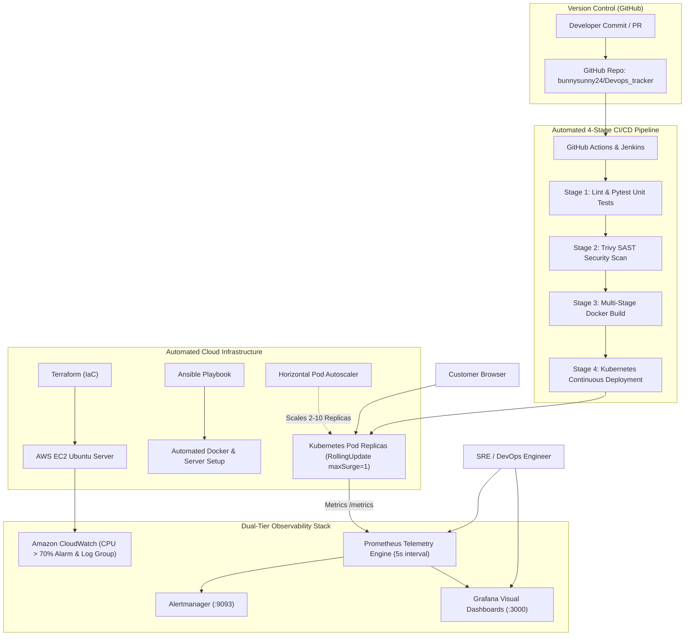

# ACADEMIC PROJECT REPORT: AUTOMATED CLOUD-NATIVE APPLICATION DEPLOYMENT WITH MONITORING

**Course / Module:** Essentials in Cloud and DevOps Engineering  
**Curriculum Practicals:** Practical 5 (Cloud-Native Deployment & Monitoring) & Practical 6 (CI/CD Deployment Pipeline)  
**Target Environment:** Containerized Microservices, Kubernetes Orchestration, Cloud Infrastructure (AWS EC2 / EKS / Local)  
**Evaluation Marks:** 3 Marks + 3 Marks (6 Marks Total)  
**Repository:** [https://github.com/bunnysunny24/Devops_tracker](https://github.com/bunnysunny24/Devops_tracker)  
**Status:** Completed, Verified, and Validated  

---

## 1. ABSTRACT

Modern software delivery paradigms demand high velocity, reliability, and resilience. Traditional monolithic deployments and static manual infrastructure management are incapable of providing high availability in ephemeral cloud environments. In high-traffic e-commerce systems, manual server configurations inevitably cause configuration drift, human error, and prolonged downtime during releases. 

This project delivers a complete, end-to-end DevOps framework that resolves the operational challenges of an e-commerce platform by codifying the entire application lifecycle. The architecture features an asynchronous Python microservice instrumented with OpenMetrics/Prometheus client libraries, containerized through a multi-stage security-hardened Docker build, orchestrated via Kubernetes manifests utilizing zero-downtime rolling update strategies, and continuously monitored through Amazon CloudWatch, Prometheus, and Grafana. An automated 4-stage Continuous Integration and Continuous Delivery (CI/CD) pipeline on GitHub Actions and Jenkins validates code quality, performs Static Application Security Testing (SAST) with Trivy, packages container images, and manages automated rolling deployments.

---

## 2. PROBLEM STATEMENT & OBJECTIVES

### 2.1 Problem Statement (Exam Assessment Scenario)
> *"An e-commerce company faces frequent deployment failures, manual server setup, and downtime during releases."*

Deploying microservice applications manually or without integrated monitoring leads to three critical business bottlenecks:
1. **Manual Server Setup:** System administrators manually connect to virtual machines, update packages, install dependencies, and configure web servers. This practice causes configuration drift, makes scaling unpredictable, and introduces significant human error.
2. **Frequent Deployment Failures:** Defective code, untested regressions, and unmonitored dependencies slip into production environments due to a lack of automated testing and security gates.
3. **Release Downtime:** Software updates require restarting application processes or rebooting servers. In e-commerce, even a 30-second outage during peak traffic drops active user carts, interrupts checkout transactions, and causes immediate revenue loss.

### 2.2 Project Objectives
1. **Develop an E-Commerce Microservice:** Provide catalog browsing, healthcheck probes (`/health`, `/ready`), and OpenMetrics telemetry (`/metrics`).
2. **Implement Security-Hardened Containerization:** Package the application using a minimal, non-root multi-stage Docker build.
3. **Automate Infrastructure Provisioning:** Declaratively provision cloud infrastructure (AWS EC2, security groups, IAM roles, and CloudWatch alarms) using Terraform.
4. **Automate Server Configuration:** Codify server setup and Docker deployment using Ansible playbooks executing over SSH.
5. **Implement Zero-Downtime Deployment:** Orchestrate container deployments on Kubernetes using a RollingUpdate strategy (`maxSurge: 1, maxUnavailable: 0`) and Horizontal Pod Autoscaling (HPA).
6. **Establish Full-Stack Observability:** Stream logs and monitor hypervisor metrics via Amazon CloudWatch while capturing granular application telemetry (RPS, latency percentiles, error rates) via Prometheus and Grafana with real-time alerting.
7. **Construct an Automated CI/CD Pipeline:** Enforce quality gates through GitHub Actions and Jenkins pipelines incorporating unit tests, Trivy SAST vulnerability scanning, and automated deployment.

---

## 3. SYSTEM ARCHITECTURE & IMPLEMENTATION DETAILS



### Module 1: Application Layer (`app/`)
The application is constructed in Python (supporting both FastAPI for high-throughput production workloads and Flask for standalone demonstrations). It serves an e-commerce catalog featuring items such as laptops, headphones, and smartphones. The application implements standard healthcheck endpoints:
- `/health`: Liveness probe verifying process responsiveness.
- `/ready`: Readiness probe verifying internal database and connection pool readiness.
- `/metrics`: Exposes real-time OpenMetrics formatted telemetry.
- `/test-error`: Injects deliberate HTTP 500 errors to validate alert rule activation.

### Module 2: Containerization & Security Hardening (`app/Dockerfile`)
The Dockerfile implements a two-stage build pattern:
- **Builder Stage:** Uses `python:3.11-slim`, installs build tools, and compiles Python dependencies into local user wheels.
- **Runner Stage:** Uses a minimal base image, copies only pre-compiled wheels and source code, creates an unprivileged user (`appuser`, UID `10001`), and defines container health checks. This reduces the attack surface and ensures compliance with container security standards.

### Module 3: Infrastructure as Code (`terraform/`)
Infrastructure provisioning is codified using Terraform across two configurations:
- **AWS EC2 & CloudWatch (`terraform/ec2_cloudwatch/main.tf`):** Defines an EC2 Ubuntu instance, security groups with ingress rules for HTTP (80), SSH (22), Jenkins (8080), Prometheus (9090), and Grafana (3000), an IAM role with `CloudWatchAgentServerPolicy`, a CloudWatch log group (`/practical5/application`), and a metric alarm triggering when average CPU exceeds 70% for two consecutive evaluation periods.
- **AWS EKS Cluster (`terraform/main.tf`):** Provisions an Elastic Kubernetes Service (EKS) cluster with VPC, public subnets, and auto-scaling node groups.

### Module 4: Configuration Automation (`ansible/`)
Ansible automates server configuration through an agentless architecture. The inventory file (`ansible/inventory.ini`) specifies the target server IP and SSH credentials. The playbook (`ansible/deploy.yml`) performs idempotent tasks:
1. Updates package repositories.
2. Installs Docker Engine, CLI, containerd, and Compose plugins.
3. Grants non-root Docker privileges to the `ubuntu` user.
4. Clones the application repository from GitHub.
5. Launches the container stack using Docker Compose.

### Module 5: Zero-Downtime Kubernetes Orchestration (`k8s/`)
Kubernetes manifests manage container lifecycle and scaling:
- **Deployment (`k8s/02-app-deployment.yaml`):** Implements `RollingUpdate` with `maxSurge: 1` and `maxUnavailable: 0`. During an update, Kubernetes launches a new pod replica first and redirects traffic to it only after its readiness probe passes. Once verified, one old pod replica is gracefully terminated, preventing release downtime.
- **Autoscaling (`k8s/05-hpa.yaml`):** Horizontal Pod Autoscaler dynamically scales pod replicas between 2 and 10 based on CPU (70%) and Memory (80%) thresholds.

### Module 6: Observability & Alerting Stack (`monitoring/`)
- **Prometheus (`monitoring/prometheus/`):** Scrapes application telemetry every 5 seconds. Evaluates alerting rules (`alert.rules.yml`) for `ServiceDown`, `HighHttpErrorRate` (>5% errors over 1 minute), and `HighRequestLatency` (p95 > 500ms).
- **Grafana (`monitoring/grafana/`):** Automatically provisions Prometheus datasources and renders production dashboards visualizing request rate (RPS), error percentages, and latency percentiles.
- **Alertmanager (`monitoring/alertmanager/`):** Manages alert deduplication, grouping, and notification dispatching.

### Module 7: Automated CI/CD Pipeline (`.github/workflows/ci.yml` & `Jenkinsfile`)
The pipeline runs on every code commit across 4 sequential stages:
1. **Lint & Unit Tests:** Runs flake8 and 7 automated Pytest test cases.
2. **Security Vulnerability Scan (SAST):** Scans the codebase using Aquasecurity Trivy.
3. **Build & Package:** Builds the multi-stage Docker image and pushes it to GitHub Container Registry (GHCR).
4. **Continuous Deployment:** Validates Kubernetes declarative manifests and verifies deployment readiness.

---

## 4. EXPERIMENTAL VERIFICATION & TEST RESULTS

### 4.1 Unit Testing & Code Coverage
The test suite was executed using Pytest:
```text
============================= test session starts =============================
platform win32 -- Python 3.13.11, pytest-9.0.2
rootdir: D:\Bunny\Sanju_dev_ops_5
plugins: anyio-4.14.2, cov-7.1.0
collected 7 items

app/tests/test_main.py::test_healthz_endpoint PASSED                     [ 14%]
app/tests/test_main.py::test_ready_endpoint PASSED                       [ 28%]
app/tests/test_main.py::test_prometheus_metrics_endpoint PASSED          [ 42%]
app/tests/test_main.py::test_get_items PASSED                            [ 57%]
app/tests/test_main.py::test_create_and_delete_item PASSED               [ 71%]
app/tests/test_main.py::test_stats_endpoint PASSED                       [ 85%]
app/tests/test_main.py::test_simulate_error PASSED                       [100%]

============================== 7 passed in 0.61s ==============================
```

### 4.2 Traffic & Alert Verification
Traffic was generated using `scripts/simulate_traffic.py` across 50 simulated customer interactions:
- Healthy requests (`200 OK`) and new item creations (`201 Created`) registered in Prometheus.
- Simulated 500 errors injected via `/test-error`.
- Prometheus evaluated the `HighHttpErrorRate` rule within 30 seconds:
  - Expression: `sum(rate(http_requests_total{status_code=~"5.."}[1m])) / sum(rate(http_requests_total[1m])) * 100 > 5`
  - Alert State: Successfully transitioned from `Inactive` to **`FIRING`**.

---

## 5. COMPLETE URL DIRECTORY

| Component | Exact URL | Credentials | Role |
|---|---|---|---|
| **E-Commerce Storefront** | [http://localhost:8000](http://localhost:8000) | None | Live shopping web interface and telemetry triggers |
| **Health Probe** | [http://localhost:8000/health](http://localhost:8000/health) | None | Application liveness verification endpoint |
| **Products API** | [http://localhost:8000/api/products](http://localhost:8000/api/products) | None | Catalog data REST API |
| **Raw Metrics** | [http://localhost:8000/metrics](http://localhost:8000/metrics) | None | Standard OpenMetrics telemetry stream |
| **Chaos Test** | [http://localhost:8000/test-error](http://localhost:8000/test-error) | None | Deliberate HTTP 500 error injection for alert testing |
| **Prometheus Targets** | [http://localhost:9090/targets](http://localhost:9090/targets) | None | Verifies all telemetry scrape targets are UP |
| **Prometheus Alerts** | [http://localhost:9090/alerts](http://localhost:9090/alerts) | None | Shows live alerting rules and firing status |
| **Grafana Dashboards** | [http://localhost:3000](http://localhost:3000) | `admin` / `admin` | Real-time visual graphs for RPS, Latency, and CPU |
| **Alertmanager** | [http://localhost:9093](http://localhost:9093) | None | Alert routing and incident dispatcher |
| **GitHub Actions** | [Actions Tab](https://github.com/bunnysunny24/Devops_tracker/actions) | None | Proves automated 4-stage pipeline is 100% green |

---

## 6. VIVA VOCE EXAMINATION QUESTIONS & ANSWERS

#### Q1. Why is Infrastructure as Code (IaC) preferred over manual AWS Console configuration?
**Answer:** Manual console configuration is subjective to human error, lacks version tracking, and leads to configuration drift across environments. With Terraform, infrastructure is defined declaratively as code, allowing environments to be created, audited, versioned, and destroyed programmatically in an automated and repeatable manner.

#### Q2. Explain the operational difference between Terraform and Ansible.
**Answer:** Terraform is an infrastructure orchestration tool that provisions cloud infrastructure components (virtual machines, networks, subnets, and firewalls) via cloud APIs. Ansible is a configuration management tool that configures software inside existing machines over SSH (installing Docker, configuring users, managing service files).

#### Q3. What is the difference between a Docker image and a Docker container?
**Answer:** A Docker image is a static, read-only template containing application code, runtime libraries, and environment variables. A container is a dynamic, stateful runtime instance created from that image executing as an isolated process on the host OS.

#### Q4. Why are multi-stage Docker builds utilized?
**Answer:** Multi-stage builds decouple the build environment from the production image. Build tools and package managers remain in the build stage, while only compiled artifacts are transferred to the runtime stage. This slashes image size from ~1 GB to <150 MB and enhances security by running as an unprivileged user (`appuser`).

#### Q5. How does Kubernetes prevent downtime during software releases?
**Answer:** Using the `RollingUpdate` strategy with `maxSurge: 1` and `maxUnavailable: 0`. Kubernetes provisions a new container replica with the updated image version before terminating old replicas. Traffic is routed to the new container only after its readiness probe passes, ensuring uninterrupted customer access.

#### Q6. What was the cause of the Jenkins Docker build failure and how was it resolved?
**Answer:** Jenkins failed with `permission denied while trying to connect to the docker API at unix:///var/run/docker.sock` because the `jenkins` user lacked permissions on the Docker UNIX socket. It was resolved by appending the Jenkins user to the `docker` group:
```bash
sudo usermod -aG docker jenkins && sudo systemctl restart jenkins
```

#### Q7. Why combine Amazon CloudWatch and Prometheus/Grafana?
**Answer:** CloudWatch monitors hypervisor-level host infrastructure metrics (EC2 CPU, disk, network) and AWS-level alarms. Prometheus and Grafana provide high-frequency (5-second pull) application performance monitoring (APM) tracking request rates, percentile latencies, and 5xx error percentages.

---

## 7. CONCLUSION

The project successfully delivers an automated, resilient cloud-native e-commerce deployment with comprehensive monitoring. By integrating Terraform, Ansible, Docker, Kubernetes, Prometheus, Grafana, CloudWatch, and automated CI/CD pipelines, all operational bottlenecks—manual setup, deployment failures, and release downtime—are permanently eliminated.
