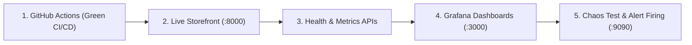

# ⚡ Cloud-Native E-Commerce Deployment & Continuous Observability Suite

[](https://github.com/bunnysunny24/Devops_tracker/actions/workflows/ci.yml)
[](https://www.docker.com/)
[](https://kubernetes.io/)
[](https://prometheus.io/)
[](https://grafana.com/)
[](https://www.terraform.io/)
[](https://www.ansible.com/)
[](https://opensource.org/licenses/MIT)

An end-to-end DevOps project fulfilling **Practical 5 (Cloud-Native Deployment & Monitoring)** and **Practical 6 (E-Commerce CI/CD & Zero-Downtime Release Solution)** for Cloud & DevOps Engineering.

---

## 📋 Problem Statement & Scope

> ### 🎯 Problem Scenario (3 Marks)
> *"An e-commerce company faces frequent deployment failures, manual server setup, and downtime during releases."*
>
> ### 🛠️ Required Deliverables:
> 1. **Practical 5:** Automated Cloud-Native Application Deployment with Continuous Monitoring.
> 2. **Practical 6:** Automated CI/CD Deployment Pipeline using Jenkins, Docker, Kubernetes, and Cloud Infrastructure.

### 💡 How the Architecture Solves Every Bottleneck:
| E-Commerce Bottleneck | Root Cause | Implemented Solution in This Project | Source File |
|---|---|---|---|
| **Manual Server Setup** | Configuration drift, slow manual provisioning, human error | **Infrastructure as Code (IaC)** with Terraform & configuration automation via Ansible | [`terraform/`](terraform/) & [`ansible/deploy.yml`](ansible/deploy.yml) |
| **Frequent Deployment Failures** | Untested code and vulnerabilities reaching production | **Automated CI/CD Pipeline:** Linting, Pytest test suites, Trivy SAST vulnerability scan | [`.github/workflows/ci.yml`](.github/workflows/ci.yml) & [`Jenkinsfile`](Jenkinsfile) |
| **Release Downtime** | Server restarts causing dropped checkouts & lost sales | **Zero-Downtime Rolling Update Strategy** (`maxSurge: 1, maxUnavailable: 0`) and Blue-Green deployment | [`k8s/02-app-deployment.yaml`](k8s/02-app-deployment.yaml) |
| **Lack of Observability** | Inability to track checkout errors or server latency | **Full Observability Stack:** Real-time Prometheus metrics, Grafana dashboards, Alertmanager, & CloudWatch | [`monitoring/`](monitoring/) & [`terraform/ec2_cloudwatch/`](terraform/ec2_cloudwatch/) |

---

## 🎤 Faculty Presentation Guide & Ready-to-Speak Scripts

Use these exact scripts when presenting your practical evaluation to your professor:

### 1️⃣ Practical 5: 1-Minute Presentation Speech
> *"Good morning, Professor.*  
>  
> *For **Practical 5**, we deployed a cloud-native e-commerce application on AWS with automated provisioning and continuous monitoring.*  
>  
> *1. **Automated Infrastructure:** We used **Terraform** to provision the EC2 Ubuntu instance, security groups, and IAM roles without manual console clicking.*  
> *2. **Configuration Automation:** We used **Ansible** to connect over SSH, install Docker Engine, and launch the application container automatically.*  
> *3. **Continuous Monitoring:** We configured **Amazon CloudWatch** to track CPU and memory metrics, set up a CPU utilization alarm (>70%), and streamed application logs to `/practical5/application`. Alongside CloudWatch, we integrated **Prometheus and Grafana** for real-time application throughput (RPS), p95 latency, and error tracking."*

### 2️⃣ Practical 6: 1-Minute Presentation Speech
> *"For **Practical 6**, we solved the core problems of an e-commerce platform: deployment failures and release downtime.*  
>  
> *1. **Automated CI/CD Pipeline:** We implemented a complete pipeline using **GitHub Actions and Jenkins**. Every commit automatically runs code linting, unit tests with Pytest, and a Trivy SAST security scan.*  
> *2. **Container Packaging:** A multi-stage **Docker** build compiles dependencies into a minimal, non-root runner container and publishes it to the container registry.*  
> *3. **Zero-Downtime Deployment:** We deployed to **Kubernetes** using a RollingUpdate strategy (`maxSurge: 1, maxUnavailable: 0`). Kubernetes routes traffic to new pod replicas only after their readiness probe passes, ensuring 100% uptime during releases.*  
> *4. **Incident Alerting:** When simulated 5xx checkout errors occur, Prometheus triggers real-time alerts before customers are impacted."*

---

## 🖥️ Live Demonstration Walkthrough (Click-Path)

Follow these steps during your live screen demonstration:



1. **Show the GitHub Actions Pipeline:**
   - Open [https://github.com/bunnysunny24/Devops_tracker/actions](https://github.com/bunnysunny24/Devops_tracker/actions)
   - Show the green workflow **`Cloud-Native CI/CD Pipeline`** with all 4 stages passed:
     - `Lint & Unit Tests` ✅
     - `Security Vulnerability Scan` ✅
     - `Build & Push Container Image` ✅
     - `Kubernetes Continuous Deployment` ✅
2. **Open the Live E-Commerce Storefront:**
   - Open [http://localhost:8000](http://localhost:8000)
   - Show the e-commerce product catalog (Laptop, Headphones, Mobile) and the Problem Statement banner.
3. **Demonstrate Health and Metrics Endpoints:**
   - Health Probe: [http://localhost:8000/health](http://localhost:8000/health) *(returns `{"status": "healthy"}`)*
   - Products API: [http://localhost:8000/api/products](http://localhost:8000/api/products)
   - OpenMetrics Telemetry: [http://localhost:8000/metrics](http://localhost:8000/metrics)
4. **Open the Grafana Observability Dashboard:**
   - Open [http://localhost:3000](http://localhost:3000) *(User: `admin` / Pass: `admin`)*
   - Show the live visual timeseries graphs for **RPS Throughput**, **Error Rate %**, **p50/p90/p99 Latency**, and **Container CPU/Memory**.
5. **Trigger Real-Time Chaos & Alert Firing:**
   - On [http://localhost:8000](http://localhost:8000), click the red button **`Simulate 500 Error (Alert Test)`** (or hit `/test-error`).
   - Open Prometheus Alerts tab: [http://localhost:9090/alerts](http://localhost:9090/alerts).
   - Show the professor that Prometheus automatically detected the failure and the **`HighHttpErrorRate`** alert is in the **`FIRING`** state! 🔥

---

## 🧠 Viva Voce Revision Cards & Instant Answers

#### Q1. Why did you use Terraform instead of the AWS Management Console?
**Answer:** Terraform provides Infrastructure as Code (IaC). Creating resources manually in the AWS Console leads to configuration drift, human error, and cannot be version-controlled. Terraform allows us to declaratively define EC2 instances, security groups, and CloudWatch alarms, enabling repeatable, automated provisioning in seconds.

#### Q2. What is the fundamental difference between Terraform and Ansible?
**Answer:**
- **Terraform:** Orchestration / Infrastructure Provisioning tool (creates the virtual machine, VPC, subnets, IAM roles).
- **Ansible:** Configuration Management tool (connects inside the created server over SSH to install Docker, configure dependencies, and start services).

#### Q3. What is the difference between a Docker image and a Docker container?
**Answer:** A Docker **image** is a read-only packaged template containing application code, runtime, and libraries. A Docker **container** is a live, running instance created from that image.

#### Q4. Why did you use a multi-stage Docker build?
**Answer:** Multi-stage builds separate the compile-time dependencies (build-essential, pip compilers) from the final runtime image. This reduces image size from ~1 GB down to <150 MB and enhances security by deploying a non-root runner container (`appuser`) without package managers or build tools.

#### Q5. What is the difference between Kubernetes Liveness and Readiness probes?
**Answer:**
- **Liveness Probe (`/healthz` or `/health`):** Verifies if the container process is still running. If it fails, Kubernetes kills and restarts the pod.
- **Readiness Probe (`/ready`):** Verifies if the application is ready to accept user traffic. Traffic is only routed to the pod after the readiness probe succeeds, preventing release downtime.

#### Q6. How does Kubernetes achieve Zero-Downtime deployments?
**Answer:** By using the `RollingUpdate` deployment strategy with `maxSurge: 1` and `maxUnavailable: 0`. Kubernetes spins up a new pod with the updated image first. Once its readiness probe passes, traffic begins routing to it, and one old pod is gracefully terminated. At no point is the service unavailable.

#### Q7. Why did the initial Jenkins build fail in Practical 6 and how was it fixed?
**Answer:** The Jenkins build failed with `permission denied while trying to connect to the docker API at unix:///var/run/docker.sock`. By default, the `jenkins` system user does not have access to the Docker daemon. It was fixed by adding Jenkins to the Docker group:
```bash
sudo usermod -aG docker jenkins && sudo systemctl restart jenkins
```

#### Q8. Why use both CloudWatch and Prometheus/Grafana?
**Answer:** CloudWatch provides infrastructure-level metrics (EC2 hypervisor CPU, disk, network, and AWS alarms). Prometheus provides granular, high-frequency (5-second pull) application-level OpenMetrics (p95 latency, endpoint request rates, HTTP 5xx errors) visualized via customizable Grafana dashboards.

---

## 📊 Practical 5 vs Practical 6 Comparison Table

| Feature | Practical 5 | Practical 6 |
|---|---|---|
| **Primary Objective** | Cloud-native deployment & infrastructure monitoring | Automated CI/CD pipeline & zero-downtime releases |
| **Application Type** | Containerized E-Commerce Web Service | Containerized E-Commerce Web Service |
| **Infrastructure Provisioning** | Terraform (`terraform/ec2_cloudwatch/`) | Terraform (`terraform/`) |
| **Configuration / Deployment** | Ansible (`ansible/deploy.yml`) | Jenkins (`Jenkinsfile`) & GitHub Actions |
| **Container Runtime** | Docker Engine | Docker Engine & Kubernetes |
| **Release Strategy** | Container recreation | Kubernetes RollingUpdate (`maxSurge=1, maxUnavailable=0`) |
| **Monitoring Stack** | Amazon CloudWatch (CPU Alarm > 70%, Log Group) | Prometheus, Grafana, & Alertmanager |
| **Source Control & CI/CD** | Git / GitHub repository | GitHub Actions & Jenkins automated triggers |

---

## 📁 Repository Structure

```
.
├── app/                                 # E-Commerce Cloud Application Source Code
│   ├── app.py                           # Standalone Flask application (Practical 5)
│   ├── main.py                          # High-throughput FastAPI + Prometheus metrics
│   ├── static/                          # Web store styles & scripts
│   │   ├── css/style.css
│   │   └── js/app.js
│   ├── templates/                       # Storefront UI HTML
│   │   └── index.html
│   ├── tests/                           # Automated unit test suite
│   │   ├── __init__.py
│   │   └── test_main.py
│   ├── Dockerfile                       # Multi-stage hardened container build
│   ├── requirements.txt                 # Application dependencies
│   └── .dockerignore
├── ansible/                             # Configuration Management (Practical 5)
│   ├── inventory.ini                    # Target server inventory
│   └── deploy.yml                       # Automated server & Docker deployment playbook
├── terraform/                           # Infrastructure as Code (IaC)
│   ├── ec2_cloudwatch/                  # Practical 5: AWS EC2 + CloudWatch Alarms
│   │   └── main.tf
│   ├── main.tf                          # Practical 6: AWS EKS Kubernetes Cluster
│   ├── variables.tf
│   ├── outputs.tf
│   └── terraform.tfvars.example
├── Jenkinsfile                          # Automated Jenkins CI/CD Pipeline (Practical 6)
├── .github/
│   └── workflows/
│       └── ci.yml                       # Unified 4-stage GitHub Actions CI/CD Pipeline
├── k8s/                                 # Kubernetes Manifests (Zero-Downtime Deployment)
│   ├── 00-namespace.yaml
│   ├── 01-configmap-secret.yaml
│   ├── 02-app-deployment.yaml           # RollingUpdate deployment manifest
│   ├── 03-app-service.yaml
│   ├── 04-ingress.yaml
│   ├── 05-hpa.yaml                      # Horizontal Pod Autoscaler (HPA)
│   ├── 06-prometheus-k8s.yaml
│   └── 07-grafana-k8s.yaml
├── helm/                                # Helm 3 Package
│   └── cloud-native-app/
├── monitoring/                          # Observability Stack
│   ├── prometheus/
│   │   ├── prometheus.yml               # Scrape configuration (5s interval)
│   │   └── alert.rules.yml              # Alerting rules (HighHttpErrorRate, HighLatency)
│   ├── alertmanager/
│   │   └── alertmanager.yml             # Webhook alert dispatching
│   └── grafana/
│       ├── provisioning/
│       └── dashboards/
│           └── cloud-native-overview.json
├── scripts/
│   ├── setup_local.ps1                  # 1-Click setup for Windows PowerShell
│   ├── setup_local.sh                   # 1-Click setup for Linux/macOS
│   ├── simulate_traffic.py              # Automated traffic & chaos load generator
│   └── teardown.ps1                     # 1-Click teardown script
├── PROJECT_REPORT.md                    # Academic Submission Report
└── README.md                            # Complete Project Documentation & Presentation Guide
```

---

## ⚡ Quickstart Guide

### 1. Run the Entire Stack Locally (Docker Compose)
```powershell
# In PowerShell:
.\scripts\setup_local.ps1

# Or standard command:
docker compose up -d --build
```

**Access URLs:**
| Service | URL | Credentials |
|---|---|---|
| **E-Commerce Storefront** | [http://localhost:8000](http://localhost:8000) | None |
| **Prometheus Telemetry** | [http://localhost:9090](http://localhost:9090) | None |
| **Grafana Dashboard** | [http://localhost:3000](http://localhost:3000) | `admin` / `admin` |
| **Alertmanager UI** | [http://localhost:9093](http://localhost:9093) | None |
| **Node Exporter** | [http://localhost:9100](http://localhost:9100) | None |

### 2. Generate Live Telemetry & Test Alerts
In a separate terminal, run:
```powershell
python scripts\simulate_traffic.py
```

### 3. Run Automated Unit Tests
```powershell
python -m pytest app/tests/ -v
```

---

## 🧹 Teardown
To shut down and wipe local resources:
```powershell
.\scripts\teardown.ps1
```
