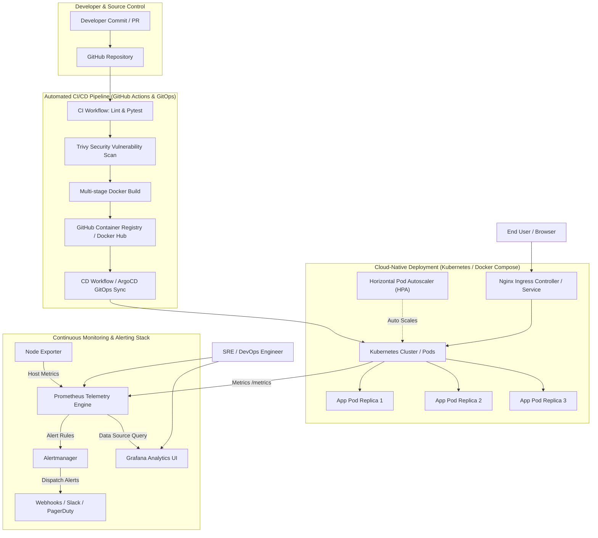

# ⚡ Automated Cloud-Native Application Deployment with Monitoring

[](https://github.com/sanju-devops/automated-cloud-native-deployment/actions)
[](https://opensource.org/licenses/MIT)
[](https://kubernetes.io/)
[](https://prometheus.io/)
[](https://grafana.com/)
[](https://www.terraform.io/)

An end-to-end, enterprise-grade DevOps project featuring an **Automated Cloud-Native Application Deployment pipeline** accompanied by a full-stack **Continuous Monitoring and Observability infrastructure**.

---

## 📌 Architecture Overview



---

## 🚀 Key Features

1. **Cloud-Native Microservice (`app/`)**:
   - Built with **Python 3.11** & **FastAPI** for high performance asynchronous request handling.
   - Built-in OpenMetrics/Prometheus client exposing custom telemetry (`http_requests_total`, `http_request_duration_seconds`, `app_system_cpu_usage_percent`, `http_active_requests`).
   - Standard Kubernetes probes: `/healthz` (liveness) and `/ready` (readiness).
   - Chaos & load simulation endpoints (`/api/simulate/error`, `/api/simulate/slow`, `/api/simulate/load`).
   - Rich interactive web dashboard showing real-time telemetry and management controls.

2. **Secure Containerization (`Dockerfile`)**:
   - Multi-stage build pattern resulting in a minimal, secure, non-root runner container (`appuser`, UID `10001`).
   - Built-in container health check.

3. **Infrastructure as Code (`terraform/`)**:
   - Modular Terraform scripts for provisioning an **AWS EKS** (Elastic Kubernetes Service) cluster, VPC, public subnets, Internet Gateway, IAM Roles, and managed EC2 worker node groups.

4. **Production Kubernetes & Helm (`k8s/` & `helm/`)**:
   - Declarative manifests: Namespaces, ConfigMaps, Secrets, Deployments (RollingUpdate strategy: `maxSurge=1, maxUnavailable=0`), NodePort/ClusterIP Services, and Ingress routing.
   - **Horizontal Pod Autoscaler (HPA)** configured with CPU (70%) and Memory (80%) thresholds.
   - Production Helm 3 chart with parameterized `values.yaml` for multi-environment deployments.

5. **Full Observability & Alerting Stack (`monitoring/`)**:
   - **Prometheus**: Automated scraping every 5s with rule evaluations.
   - **Alertmanager**: Routing alerts for ServiceDown, HighHttpErrorRate (>5%), HighLatency (p95 > 500ms), and HighCpuUsage.
   - **Grafana**: Pre-provisioned Prometheus datasource and production ready dashboard (`cloud-native-overview.json`) with RPS, percentile latencies, CPU/memory graphs, and error rate percentages.
   - **Node Exporter**: System-level hardware and OS telemetry.

6. **Continuous Integration & GitOps Continuous Deployment (`.github/` & `gitops/`)**:
   - Linting, flake8, pytest coverage.
   - Security scanning with Aquasecurity Trivy SAST.
   - Automated zero-downtime rolling deployment with automatic rollback on healthcheck failure.
   - ArgoCD Application manifest for declarative GitOps synchronization.

---

## 📁 Repository Structure

```
.
├── app/                                 # Cloud-Native Application Source Code
│   ├── main.py                          # FastAPI backend + Prometheus metrics engine
│   ├── static/                          # Web dashboard CSS & JS
│   │   ├── css/style.css
│   │   └── js/app.js
│   ├── templates/                       # Jinja2 HTML web interface
│   │   └── index.html
│   ├── tests/                           # Pytest unit tests
│   │   ├── __init__.py
│   │   └── test_main.py
│   ├── Dockerfile                       # Multi-stage hardened Dockerfile
│   ├── requirements.txt                 # Application dependencies
│   └── .dockerignore                    # Build ignore rules
├── docker-compose.yml                   # Complete local observability stack
├── monitoring/                          # Monitoring & Alerting configurations
│   ├── prometheus/
│   │   ├── prometheus.yml               # Scrape configurations & targets
│   │   └── alert.rules.yml              # Alerting rules (ServiceDown, HighLatency, etc.)
│   ├── alertmanager/
│   │   └── alertmanager.yml             # Notification routing & webhook dispatch
│   └── grafana/
│       ├── provisioning/
│       │   ├── datasources/prometheus-datasource.yml
│       │   └── dashboards/dashboards.yml
│       └── dashboards/
│           └── cloud-native-overview.json  # Pre-built monitoring dashboard
├── k8s/                                 # Native Kubernetes manifests
│   ├── 00-namespace.yaml
│   ├── 01-configmap-secret.yaml
│   ├── 02-app-deployment.yaml
│   ├── 03-app-service.yaml
│   ├── 04-ingress.yaml
│   ├── 05-hpa.yaml
│   ├── 06-prometheus-k8s.yaml
│   └── 07-grafana-k8s.yaml
├── helm/                                # Helm 3 Packaging
│   └── cloud-native-app/
│       ├── Chart.yaml
│       ├── values.yaml
│       └── templates/                   # Parameterized templates
├── terraform/                           # Infrastructure as Code (AWS EKS)
│   ├── main.tf
│   ├── variables.tf
│   ├── outputs.tf
│   └── terraform.tfvars.example
├── .github/
│   └── workflows/
│       ├── ci.yml                       # Continuous Integration & SAST
│       └── cd.yml                       # Continuous Delivery & Rollback
├── gitops/
│   └── argocd-application.yaml          # ArgoCD GitOps Manifest
├── scripts/
│   ├── setup_local.ps1                  # 1-Click setup for Windows PowerShell
│   ├── setup_local.sh                   # 1-Click setup for Linux/macOS
│   ├── simulate_traffic.py              # Automated traffic & load generator
│   └── teardown.ps1                     # 1-Click teardown script
├── PROJECT_REPORT.md                    # Formal Project Submission Report
└── README.md                            # Documentation
```

---

## ⚡ Quickstart Guide

### Option 1: Run Full Stack Locally (Docker Compose) - Recommended

1. Open a terminal in the project directory:
   ```bash
   # Windows PowerShell
   .\scripts\setup_local.ps1

   # Or standard Docker command:
   docker compose up -d --build
   ```

2. Access the services in your browser:
   | Service | URL | Default Credentials |
   |---|---|---|
   | **Application Control Plane** | [http://localhost:8000](http://localhost:8000) | None |
   | **Prometheus Dashboard** | [http://localhost:9090](http://localhost:9090) | None |
   | **Grafana Visual Analytics** | [http://localhost:3000](http://localhost:3000) | `admin` / `admin` |
   | **Alertmanager UI** | [http://localhost:9093](http://localhost:9093) | None |
   | **Node Exporter Telemetry** | [http://localhost:9100](http://localhost:9100) | None |

3. Generate realistic live traffic to observe dashboards:
   ```bash
   python scripts\simulate_traffic.py
   ```

---

### Option 2: Deploy to Kubernetes (Minikube / Kind / EKS)

1. Apply all Kubernetes manifests in order:
   ```bash
   kubectl apply -f k8s/00-namespace.yaml
   kubectl apply -f k8s/01-configmap-secret.yaml
   kubectl apply -f k8s/02-app-deployment.yaml
   kubectl apply -f k8s/03-app-service.yaml
   kubectl apply -f k8s/04-ingress.yaml
   kubectl apply -f k8s/05-hpa.yaml
   kubectl apply -f k8s/06-prometheus-k8s.yaml
   kubectl apply -f k8s/07-grafana-k8s.yaml
   ```

2. Verify pod rollout:
   ```bash
   kubectl get pods -n cloud-native -o wide
   kubectl rollout status deployment/cloud-native-app -n cloud-native
   ```

3. Or deploy via **Helm 3**:
   ```bash
   helm install cloud-native-release ./helm/cloud-native-app -n cloud-native --create-namespace
   ```

---

### Option 3: Provision Cloud Infrastructure (Terraform EKS)

1. Navigate to the terraform directory:
   ```bash
   cd terraform
   cp terraform.tfvars.example terraform.tfvars
   ```

2. Initialize and deploy:
   ```bash
   terraform init
   terraform plan
   terraform apply -auto-approve
   ```

3. Configure local `kubectl` to communicate with the newly provisioned EKS cluster:
   ```bash
   aws eks --region us-east-1 update-kubeconfig --name cloud-native-prod-cluster
   ```

---

## 🧪 Testing & Verification

### 1. Run Unit Tests & Code Coverage
```bash
pytest app/tests/ -v
```

### 2. Verify Observability & Metrics
- Query Prometheus for request rate:
  ```promql
  sum(rate(http_requests_total[1m]))
  ```
- Query p95 latency:
  ```promql
  histogram_quantile(0.95, sum(rate(http_request_duration_seconds_bucket[1m])) by (le))
  ```

### 3. Trigger Alerting Simulation
Click the chaos testing buttons on the web interface or make direct HTTP calls:
```bash
# Trigger 500 error alerts
curl http://localhost:8000/api/simulate/error?code=500

# Trigger Latency alerts
curl http://localhost:8000/api/simulate/slow?seconds=2.0

# Trigger CPU spike / HPA autoscaling
curl http://localhost:8000/api/simulate/load?iterations=5000000
```
Check Prometheus **Alerts** tab (`http://localhost:9090/alerts`) to see alerts transition from `Inactive` -> `Pending` -> `Firing`!

---

## 🧹 Teardown

To shut down and wipe local resources:
```bash
# Windows
.\scripts\teardown.ps1

# Linux / Mac
docker compose down -v
```
