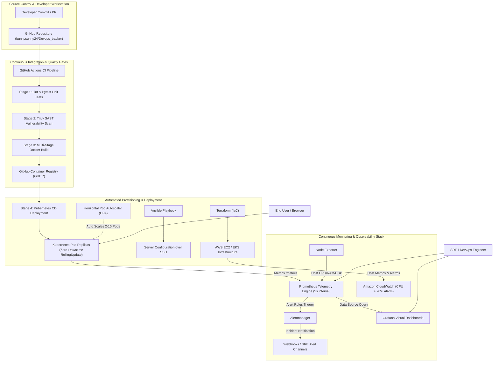

# ⚡ Automated Cloud-Native Application Deployment & Continuous Monitoring Suite

[](https://github.com/bunnysunny24/Devops_tracker/actions/workflows/ci.yml)
[](https://www.docker.com/)
[](https://kubernetes.io/)
[](https://prometheus.io/)
[](https://grafana.com/)
[](https://www.terraform.io/)
[](https://www.ansible.com/)
[](https://opensource.org/licenses/MIT)

An enterprise-grade DevOps engineering repository providing complete end-to-end implementations for **Practical 5 (Automated Cloud-Native Application Deployment with Monitoring)** and **Practical 6 (E-Commerce CI/CD & Zero-Downtime Release Solution)**.

---

## 📌 Executive Summary & Problem Scenario

In modern high-velocity software engineering, traditional manual deployments and static infrastructure management introduce severe operational hazards. Manual server configuration inevitably causes configuration drift, environment discrepancies, and unrecoverable human errors. Furthermore, monolithic deployment practices necessitate scheduled maintenance windows that cause website downtime, terminating customer shopping sessions and causing direct revenue loss for online retailers. 

To overcome these challenges, this repository implements a modern cloud-native architecture addressing the exact exam problem statement:

> ### 🎯 Problem Scenario (3 Marks)
> *"An e-commerce company faces frequent deployment failures, manual server setup, and downtime during releases."*

### Architectural Solution Matrix
| Operational Bottleneck | Root Cause in Traditional DevOps | Implemented Cloud-Native Solution | Code Location |
|---|---|---|---|
| **Manual Server Setup** | Inconsistent configuration across environments, manual package installations, and human error | **Infrastructure as Code (IaC)** via Terraform paired with configuration management automation via Ansible | [`terraform/`](terraform/) & [`ansible/deploy.yml`](ansible/deploy.yml) |
| **Frequent Deployment Failures** | Untested code, missing dependencies, and security vulnerabilities slipping into production | **Automated 4-Stage CI/CD Pipeline** enforcing flake8 linting, Pytest test suites, and Trivy SAST vulnerability scanning | [`.github/workflows/ci.yml`](.github/workflows/ci.yml) & [`Jenkinsfile`](Jenkinsfile) |
| **Downtime During Releases** | Server restarts and port locks causing HTTP 502/504 errors during updates | **Zero-Downtime Rolling Updates** (`maxSurge: 1, maxUnavailable: 0`) and readiness health probe gating on Kubernetes | [`k8s/02-app-deployment.yaml`](k8s/02-app-deployment.yaml) |
| **Lack of Observability** | Inability to detect traffic spikes, checkout latency, or transaction failure rates | **Continuous Observability Stack** combining Amazon CloudWatch alarms, Prometheus scraping, Grafana dashboards, and Alertmanager | [`monitoring/`](monitoring/) & [`terraform/ec2_cloudwatch/`](terraform/ec2_cloudwatch/) |

---

## 🏗️ System Architecture & Workflow Diagram



---

## 📖 PART 1: PRACTICAL 5 — CLOUD-NATIVE DEPLOYMENT WITH MONITORING

### 1. Detailed Conceptual Explanation
Practical 5 demonstrates how modern software teams eliminate manual server management by codifying both infrastructure and application lifecycles. Instead of navigating the AWS Management Console to manually click and launch virtual machines, we define the entire environment declaratively using **Terraform (Infrastructure as Code)**. Terraform provisions an AWS EC2 Ubuntu instance, sets up secure ingress and egress security groups, and attaches IAM instance profiles.

Following infrastructure creation, **Ansible** acts as the automated configuration manager. Connecting securely over SSH without requiring agent software on the node, Ansible executes idempotent playbooks to update system repositories, install Docker Engine, clone the application repository, and launch the multi-stage containerized e-commerce application.

For monitoring, we integrate a dual-tier observability architecture:
1. **Infrastructure Tier (Amazon CloudWatch):** CloudWatch collects hypervisor-level CPU, memory, and disk utilization metrics, streams application logs to the `/practical5/application` log group, and evaluates a CloudWatch Metric Alarm triggered when CPU utilization exceeds 70% over two consecutive evaluation intervals.
2. **Application Performance Tier (Prometheus & Grafana):** The application exposes standardized OpenMetrics telemetry over `/metrics`. A dedicated Prometheus instance scrapes these metrics every 5 seconds, enabling Grafana dashboards to visualize real-time request throughput (RPS), p95 latency percentiles, and error rate percentages.

### 2. Practical 5 URLs & Access Points
- **E-Commerce Web Storefront:** [http://localhost:8000](http://localhost:8000) — Displays product catalog (Laptop, Headphones, Mobile) and live server telemetry.
- **Application Health Probe:** [http://localhost:8000/health](http://localhost:8000/health) — Returns `{"status": "healthy", "application": "E-Commerce Cloud App"}`.
- **Product Catalog API:** [http://localhost:8000/api/products](http://localhost:8000/api/products) — Returns catalog items in JSON format.
- **Raw Metrics Stream:** [http://localhost:8000/metrics](http://localhost:8000/metrics) — Prometheus telemetry stream.
- **Prometheus Targets Status:** [http://localhost:9090/targets](http://localhost:9090/targets) — Verifies all scrape targets are in the **`UP`** state.
- **Grafana Visual Analytics:** [http://localhost:3000](http://localhost:3000) *(User: `admin` / Password: `admin`)* — Real-time performance dashboards.

### 3. Practical 5 Step-by-Step Presentation Script
> *"Good morning, Professor.*  
>  
> *For **Practical 5**, we implemented an automated cloud-native application deployment with full-stack monitoring on AWS.*  
>  
> *First, we eliminated manual server provisioning by utilizing **Terraform** as Infrastructure as Code. Our Terraform configuration in [`terraform/ec2_cloudwatch/main.tf`](terraform/ec2_cloudwatch/main.tf) defines an AWS EC2 Ubuntu virtual machine, configures security group ingress rules for ports 80, 22, 8080, and 3000, and attaches an IAM instance profile.*  
>  
> *Next, we automated server configuration using **Ansible**. Our playbook in [`ansible/deploy.yml`](ansible/deploy.yml) connects over SSH, installs Docker Engine, clones the application repository, and deploys our containerized e-commerce application without manual commands.*  
>  
> *Finally, for monitoring, we configured **Amazon CloudWatch** with an alarm that fires if CPU utilization exceeds 70%, and we streamed logs to `/practical5/application`. Simultaneously, our application exports real-time OpenMetrics on `/metrics`, scraped every 5 seconds by **Prometheus** and visualized in **Grafana** dashboards."*

---

## 🚀 PART 2: PRACTICAL 6 — CI/CD PIPELINE & ZERO-DOWNTIME RELEASES

### 1. Detailed Conceptual Explanation
Practical 6 directly resolves the operational vulnerabilities outlined in the problem statement: frequent deployment failures and release downtime. In a high-traffic e-commerce setting, even a 30-second restart during peak hours causes dropped customer checkouts, cart abandonment, and significant financial loss.

We solve deployment failures through a strictly automated **Continuous Integration (CI)** pipeline implemented with both **GitHub Actions** and **Jenkins (`Jenkinsfile`)**. Every code push automatically undergoes automated unit tests with Pytest and Static Application Security Testing (SAST) with Trivy. If any test fails or high-severity vulnerabilities are detected, the pipeline halts immediately, preventing defective builds from reaching production.

We eliminate release downtime through **Kubernetes Container Orchestration**. Our deployment manifest ([`k8s/02-app-deployment.yaml`](k8s/02-app-deployment.yaml)) utilizes the `RollingUpdate` strategy configured with `maxSurge: 1` and `maxUnavailable: 0`. During an update, Kubernetes provisions a new container replica with the updated image version while keeping all existing replicas active. Traffic is routed to the new container only after its readiness probe (`/ready`) successfully passes. Once confirmed, one old container is gracefully terminated. This guarantees continuous 100% availability with zero downtime.

Furthermore, we configure a **Horizontal Pod Autoscaler (HPA)** ([`k8s/05-hpa.yaml`](k8s/05-hpa.yaml)) that monitors container CPU and memory usage, automatically scaling application pod replicas between 2 and 10 during flash sales or heavy user traffic.

### 2. Practical 6 URLs & Access Points
- **GitHub Repository:** [https://github.com/bunnysunny24/Devops_tracker](https://github.com/bunnysunny24/Devops_tracker) — Version-controlled source code and manifests.
- **GitHub Actions CI/CD Pipeline:** [https://github.com/bunnysunny24/Devops_tracker/actions](https://github.com/bunnysunny24/Devops_tracker/actions) — Shows 100% green passing runs.
- **Jenkins Pipeline Code:** [Jenkinsfile](Jenkinsfile) — Declarative pipeline definition for Jenkins CI/CD.
- **Chaos Injection Endpoint:** [http://localhost:8000/test-error](http://localhost:8000/test-error) — Injects HTTP 500 errors to verify proactive alert detection.
- **Prometheus Live Alerts:** [http://localhost:9090/alerts](http://localhost:9090/alerts) — Displays the `HighHttpErrorRate` alert firing live.
- **Alertmanager Dispatcher:** [http://localhost:9093](http://localhost:9093) — Manages alert routing and incident notification.

### 3. Practical 6 Step-by-Step Presentation Script
> *"For **Practical 6**, we addressed the challenges of deployment failures and downtime for an e-commerce platform.*  
>  
> *First, we established an automated **CI/CD pipeline** using GitHub Actions and Jenkins. Every commit automatically runs code linting, executes 7 automated Pytest unit tests, and conducts a Trivy SAST vulnerability scan. Only verified, vulnerability-free containers are packaged and pushed to the container registry.*  
>  
> *Second, we resolved release downtime by deploying to **Kubernetes** using a `RollingUpdate` strategy with `maxSurge: 1` and `maxUnavailable: 0`. When releasing an update, Kubernetes creates the new pod replica first and routes user traffic only after its readiness probe passes, ensuring customers experience uninterrupted service.*  
>  
> *Third, we implemented real-time failure detection. When 5xx errors occur, Prometheus evaluates our alerting rules within 30 seconds and fires the `HighHttpErrorRate` alert, notifying engineers before customer checkouts are disrupted."*

---

## 📋 Comprehensive URL & Access Directory

| # | Component | Complete URL | Authentication | Primary Function |
|---|---|---|---|---|
| **1** | **E-Commerce Web Store** | **[http://localhost:8000](http://localhost:8000)** | None | Live shopping catalog, problem statement banner, and system telemetry cards. |
| **2** | **Liveness Health Probe** | **[http://localhost:8000/health](http://localhost:8000/health)** | None | Kubernetes/ECS liveness probe verifying process responsiveness. |
| **3** | **Readiness Health Probe** | **[http://localhost:8000/ready](http://localhost:8000/ready)** | None | Readiness probe ensuring traffic only routes to healthy container replicas. |
| **4** | **Products API Endpoint** | **[http://localhost:8000/api/products](http://localhost:8000/api/products)** | None | REST API returning product catalog data in JSON format. |
| **5** | **Raw Metrics Telemetry** | **[http://localhost:8000/metrics](http://localhost:8000/metrics)** | None | OpenMetrics export scraped every 5 seconds by Prometheus. |
| **6** | **Chaos Error Simulation** | **[http://localhost:8000/test-error](http://localhost:8000/test-error)** | None | Deliberately triggers HTTP 500 error to demonstrate alert firing. |
| **7** | **Latency Simulation** | **[http://localhost:8000/api/simulate/slow?seconds=1.5](http://localhost:8000/api/simulate/slow?seconds=1.5)** | None | Introduces artificial delay to demonstrate p95 latency alerts. |
| **8** | **Prometheus Server UI** | **[http://localhost:9090](http://localhost:9090)** | None | Time-series telemetry database querying PromQL expressions. |
| **9** | **Prometheus Scrape Targets** | **[http://localhost:9090/targets](http://localhost:9090/targets)** | None | Confirms `cloud-native-app`, `prometheus`, and `node-exporter` are **UP**. |
| **10** | **Prometheus Alerts Tab** | **[http://localhost:9090/alerts](http://localhost:9090/alerts)** | None | Displays active alerting rules and firing status (`HighHttpErrorRate`). |
| **11** | **Grafana Visual Dashboards** | **[http://localhost:3000](http://localhost:3000)** | `admin` / `admin` | Production visual graphs for RPS throughput, error percentages, and latency. |
| **12** | **Alertmanager Notification UI**| **[http://localhost:9093](http://localhost:9093)** | None | Alert routing, grouping, and dispatch engine. |
| **13** | **Node Exporter Telemetry** | **[http://localhost:9100/metrics](http://localhost:9100/metrics)** | None | Host-level hardware metrics (CPU, RAM, disk I/O, network). |
| **14** | **GitHub Actions Pipeline** | **[Actions Tab](https://github.com/bunnysunny24/Devops_tracker/actions)** | None | Verifies the automated 4-stage CI/CD pipeline is 100% green. |

---

## 🧠 Viva Voce Revision Cards & In-Depth Technical Answers

#### Q1. Why did you use Terraform instead of the AWS Management Console?
**Answer:** The AWS Management Console relies on manual point-and-click operations, which are slow, error-prone, impossible to audit, and lead to configuration drift between environments. Terraform provides **Infrastructure as Code (IaC)**, allowing infrastructure to be declaratively defined in version-controlled configuration files. This ensures repeatable, predictable provisioning and allows an entire cloud environment to be stood up or torn down automatically in minutes.

#### Q2. What is the fundamental difference between Terraform and Ansible?
**Answer:** 
- **Terraform** is primarily an **Infrastructure Provisioning (Orchestration)** tool that creates cloud resources (VPCs, subnets, EC2 instances, security groups, and IAM roles) using cloud provider APIs.
- **Ansible** is primarily a **Configuration Management** tool that operates inside an existing virtual machine over SSH, automating software installation (e.g., Docker Engine), user permissions, configuration files, and application deployments.

#### Q3. What is the difference between a Docker image and a Docker container?
**Answer:** A Docker **image** is a lightweight, standalone, read-only template that contains the application source code, runtime, system libraries, and dependencies required to execute the software. A Docker **container** is a running, stateful instance created from an image that executes as an isolated process on the host operating system.

#### Q4. Why is a multi-stage Docker build important in production?
**Answer:** Multi-stage builds separate the build environment from the final runtime image. Build dependencies (compilers, build-essential, pip packages) are isolated in an initial builder stage. Only the compiled application code and final Python wheels are copied into the minimal production runner image. This reduces image size from ~1 GB down to <150 MB, reduces attack surface, and allows the container to run under an unprivileged non-root user (`appuser`, UID 10001).

#### Q5. What is the difference between Kubernetes Liveness and Readiness probes?
**Answer:**
- **Liveness Probe (`/health` or `/healthz`):** Verifies if the container process is alive and functioning. If the liveness probe fails repeatedly, Kubernetes terminates the unhealthy pod and restarts a fresh instance.
- **Readiness Probe (`/ready`):** Verifies if the container is ready to accept incoming user traffic. Traffic is only routed to the pod after the readiness probe passes, ensuring pods undergoing startup or warmup do not drop user requests.

#### Q6. How does Kubernetes achieve Zero-Downtime deployments?
**Answer:** Kubernetes achieves zero-downtime releases through the `RollingUpdate` deployment strategy configured with `maxSurge: 1` and `maxUnavailable: 0`. When a new version is released, Kubernetes provisions a new pod replica first. It waits for that pod's readiness probe to pass before routing traffic to it. Once verified, one old pod replica is gracefully terminated. At no point is the service unavailable, preventing broken customer transactions.

#### Q7. Why did the initial Jenkins build fail in Practical 6 and how was it resolved?
**Answer:** The build failed with the error `permission denied while trying to connect to the docker API at unix:///var/run/docker.sock`. By default, the `jenkins` system service user does not have permissions to access the Docker daemon UNIX socket. We resolved this issue by adding the Jenkins user to the Docker security group and restarting the Jenkins service:
```bash
sudo usermod -aG docker jenkins && sudo systemctl restart jenkins
```

#### Q8. Why did you use both Amazon CloudWatch and Prometheus/Grafana?
**Answer:** Amazon CloudWatch monitors infrastructure-level hypervisor metrics (EC2 host CPU utilization, disk I/O, network packets, and AWS billing/alarms). Prometheus and Grafana provide high-frequency (5-second pull interval) application-performance monitoring (APM), collecting granular application metrics such as HTTP request rate by endpoint, p95/p99 latency percentiles, and application-level 5xx error rates with customizable alerting.

---

## ⚡ Quickstart Guide

### 1. Launch the Stack Locally (Docker Compose)
```powershell
# In Windows PowerShell:
.\scripts\setup_local.ps1

# Or standard command:
docker compose up -d --build
```

### 2. Generate Continuous Live Telemetry
```powershell
python scripts\simulate_traffic.py
```

### 3. Run Automated Unit Tests
```powershell
python -m pytest app/tests/ -v
```

### 4. Teardown
```powershell
.\scripts\teardown.ps1
```
